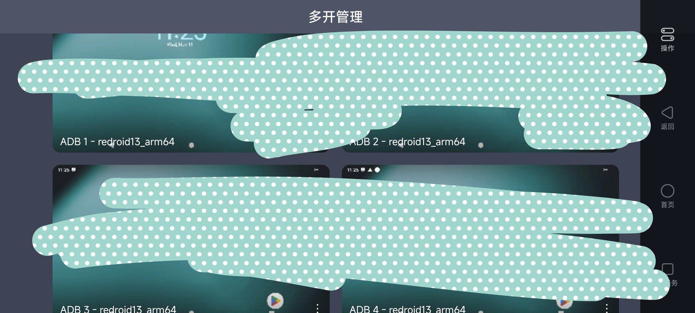

# UU Remote Patch

让本地 ADB 设备出现在 UU 远程的模拟器列表里，像操作 MuMu 一样操作手机、平板或 redroid，继续使用 UU 官方客户端和中继。

## 截图



## 用法

### 准备

- Windows x64，UU 被控端 **4.46.0.4716**。目前只适配这一构建，补丁会核对官方文件，其他版本不会启用。
- 下载本项目的部署包，再下载 [scrcpy 5.0.1 Windows x64](https://github.com/Genymobile/scrcpy/releases/tag/v5.0.1)。scrcpy 的依赖需要自己准备。
- 设备开启 ADB 调试并完成授权；无线调试先完成配对。

### 放进去

1. 解压部署包，把 scrcpy 压缩包里的文件放进 `uu-adb-patch/runtime/scrcpy/`，不要多套一层目录。里面应能直接找到 `adb.exe`、`scrcpy-server`、`avcodec-63.dll` 和 `avutil-61.dll`。
2. 打开 `uu-adb-patch/config.local.json`。USB 设备一般不用改；网络设备在 `connect` 中填写地址和端口，例如 `"connect": ["192.0.2.1:5555"]`，把示例地址换成自己的。
3. 把 **`version.dll` 和整个 `uu-adb-patch` 文件夹**复制到 UU 的 `bin` 目录，与 `GameViewerServer.exe` 放在一起。默认位置是 `C:/Program Files/Netease/GameViewer/bin`，写入这个目录通常需要管理员权限。
4. 重启 UU 被控端或电脑，手机重新打开多开管理，就能看到 ADB 设备。

最后的目录大致这样：

```text
bin/
├─ GameViewerServer.exe       # UU 原有文件
├─ version.dll               # 补丁入口
└─ uu-adb-patch/
   ├─ config.local.json      # 设备和画面设置
   ├─ runtime/scrcpy/        # 自己准备的 scrcpy 文件
   ├─ README.md
   ├─ THIRD_PARTY.md
   ├─ licenses/
   └─ manifest.json
```

配置默认使用相对路径，也可以指向已有的 ADB 和 scrcpy 目录。网络设备会按 `connect` 尝试重连。修改配置后需要重启后台；之后只要 UU 正常启动，补丁就会一起加载。

**重启被控端会断开远程连接。** 如果正在通过 UU 操作电脑，先留好重新连接的方式。安装目录已有同名 DLL 或旧补丁时，先退出后台并备份，别直接覆盖。

### 拿出来

退出 UU 后台，把 `version.dll` 改名为 `version.dll.disabled`，或移到安装目录之外，再启动 UU。配置和依赖可以保留；需要恢复时把 DLL 放回原位。

正在运行的补丁不能热卸载，只关客户端窗口也不一定退出后台。补丁不修改官方程序，不另建服务或计划任务；UU 更新后可能需要重新适配。

## 作用

- 在原模拟器列表后追加 ADB 设备，保留原来的 MuMu 实例。
- 显示多开预览和设备画面，转发触控与返回、主页、最近任务操作。
- 支持横屏及手机端上下滑动切换设备，不需要修改手机 APK。

当前已在手机端确认上述主要功能。打开多开管理时，预览仍可能短暂退回占位图；多指和长期稳定性尚未专项验证。新的复制部署方式已做独立检查，正式后台重启后的接入还等实测。

## 构建

需要 Visual Studio C++ x64 工具链和 CMake。下面以 Visual Studio 2026 为例：

```powershell
cmake -S . -B build/dropin -G "Visual Studio 18 2026" -A x64
cmake --build build/dropin --config Release
ctest --test-dir build/dropin -C Release --output-on-failure
```

生成的补丁在 `build/dropin/Release/version.dll`。提交源码后，用 PowerShell 7 运行 `./tools/package.ps1`，部署包生成在 `dist/`；包内只有 DLL、默认配置、简短说明和许可材料，不含开发文档、截图、注入工具或运行依赖。

## 文档

| 文档 | 内容 |
| --- | --- |
| [部署说明](docs/部署使用说明.md) | 配置、依赖、停用和排查 |
| [实现详解](docs/实现详解.md) | 工作原理与逐行源码说明 |
| [手机端兼容修复](docs/手机端兼容修复.md) | 颜色、方向、导航和预览闪烁 |
| [验证记录](docs/验证记录.md) | 实际通过的检查和剩余问题 |
| [接入调查](接入调查.md) | 接口依据与参考项目 |
| [续接记录](docs/续接记录.md) | 开发状态和历史候选位置 |

## 致谢

- [scrcpy](https://github.com/Genymobile/scrcpy)：ADB 画面采集与控制协议。
- [MinHook](https://github.com/TsudaKageyu/minhook)、[nlohmann/json](https://github.com/nlohmann/json)、[FFmpeg](https://github.com/FFmpeg/FFmpeg)：挂接、配置解析和视频解码。
- [uu-enhance](https://github.com/djkcyl/uu-enhance)、[better-gameviewer](https://github.com/std-microblock/better-gameviewer)：已有 UU 补丁的思路参考。
- [Antigravity-Proxy](https://github.com/yuaotian/antigravity-proxy)：目录复制部署方式与 README 写法参考。

## License

本项目自有代码暂未指定开源许可证。第三方代码按各自许可证使用，详见 [THIRD_PARTY.md](THIRD_PARTY.md)；分发补丁时请保留随包提供的声明与完整许可文件。
